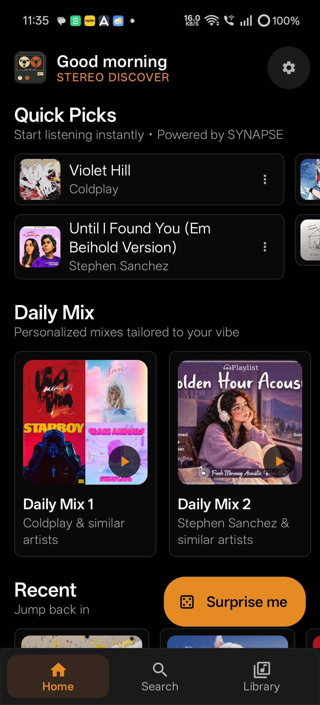
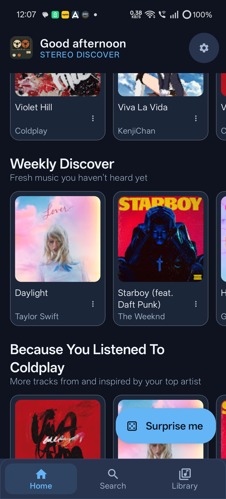

<p align="center">
  
</p>

<h1 align="center">STEREO</h1>

<p align="center">
  <strong>Original Android music player with a streamlined interface and personalized recommendations.</strong>
</p>

<p align="center">
  <a href="https://github.com/rishibandaru3109/STEREO/releases"></a>
  <a href="LICENSE"></a>
  <a href="https://developer.android.com/about/versions/oreo"></a>
  <a href="https://kotlinlang.org"></a>
  <a href="https://developer.android.com/jetpack/compose"></a>
  <a href="CONTRIBUTING.md"></a>
</p>

---

## 🌟 Overview

**STEREO** is an original Android music streaming and discovery application built from the ground up with Jetpack Compose, Kotlin Coroutines, and AndroidX Media3. STEREO combines high-fidelity audio playback with an advanced, personalized recommendation engine covering **40 mainstream languages** across the globe, automatic on-device audio caching for zero-data replays, complete playlist management, multi-source playlist importing/exporting, offline song downloads, and the autonomous **SYNAPSE** recommendation engine.

All personal preferences and listening history remain strictly on-device: zero trackers, zero telemetry, zero mandatory user accounts, and zero cloud lock-in.

---

## 🚀 What's New in Beta 2

### 1. Complete Playlist Management System
- **Comprehensive Controls:** Create, rename, edit descriptions, set custom artwork URLs, pin, duplicate, clear, and delete playlists with zero media loss.
- **Dynamic 2x2 Collage Covers:** Automatic quad-artwork generated from top playlist tracks (`PlaylistCollageCover`) with graceful single/multi-artwork fallbacks.
- **Interactive Track Sequencing:** Drag-and-drop / Move Up / Move Down reordering stored persistently in Room database.
- **8 Dynamic Sorting Orders:** Custom Order (saved), Recently Added, Oldest Added, Title (A-Z), Title (Z-A), Artist (A-Z), Artist (Z-A), and Duration.
- **Live In-Playlist Filtering:** Real-time fast search filter inside any playlist.
- **Queue Actions:** Play All, Shuffle Play, Play Next, and Add to Queue without player re-instantiation.

### 2. Universal Add-to-Playlist Bottom Sheet
- **Everywhere Access:** Accessible from Search results, Home shelves, Full Player, Queue, Liked Songs, and Playlist track rows.
- **In-Sheet Creation & Multi-Select:** Create new playlists directly inside the sheet and add to multiple playlists simultaneously.

### 3. Multi-Format Playlist Import & Export
- **Multi-Source Importer:** Public Spotify playlist URLs (`open.spotify.com/playlist/...`), YouTube Music playlists, M3U/M3U8 playlists, CSV files, and STEREO Native JSON backups.
- **Smart Track Matching:** `TrackMatchingEngine` normalizes video titles, strips remaster/HD tags, matches catalog songs, and filters out covers/karaoke.
- **Multi-Format Exporter:** Export playlists to STEREO JSON, CSV, or M3U8 via the standard Android Sharesheet.

### 4. Persistent Offline Downloads & Downloads Screen
- **Full Track Downloads:** Save songs for verified offline playback into private app storage.
- **Dedicated Downloads Hub:** Separate tabs for Downloaded, Active Queue (with live byte & % progress), and Failed transfers.
- **Airplane-Mode Playback:** Downloaded audio plays reliably with zero active network connection.
- **Startup Recovery:** Interrupted transfers automatically resume when the app launches.
- **Wi-Fi Only Toggle:** Protect mobile data with configurable Wi-Fi only download preference.

### 5. Playback Stability & UI Enhancements
- **HTTP 403 Permanent Fix:** InnerTubeX VisionOS client profile ensures unthrottled streaming without stream expiry.
- **Responsive Layouts:** Repaired tab label wrapping on narrow phone displays.

---

## 📸 Screenshots

<p align="center">
  
  &nbsp;
  
  &nbsp;
  
</p>

---

## ✨ Features

- **Music Streaming & Search:** Low-latency online catalog search and playback powered by InnerTubeX and AndroidX Media3.
- **Offline Downloads:** High-fidelity audio downloads for verified offline playback.
- **Automatic Audio Caching:** On-device streaming cache for data-free replays and offline playback of cached tracks.
- **Complete Playlist System:** Custom reordering, 8 sorting modes, 2x2 collage artwork, in-playlist search, and batch actions.
- **Playlist Import & Export:** Scrape public Spotify and YouTube Music playlists, or import/export M3U, CSV, and JSON.
- **SYNAPSE Personalized Recommendations:** Autonomous on-device recommendation engine modeling short-term vibes and long-term taste.
- **Personalized Discovery:** Dynamic Quick Picks, Daily Mixes, Weekly Discover, and "Because You Listened To" shelves.
- **Background Playback & MediaSession:** Foreground service with rich media notification controls, lock-screen artwork, and system media integration.
- **Recommendation Preferences:** Multi-select language curation across 40 languages and MMR exploration sliders.
- **Adaptive Theming:** 7 official themes including True Black (AMOLED), Frosted Glass, Cyberpunk Neon, and Material You dynamic color.

---

## 📥 Download STEREO

### Direct Download Link (Always Latest)
Get the latest public production APK:  
**[⬇️ Download STEREO Latest APK](https://github.com/rishibandaru3109/STEREO/releases/download/latest-beta/STEREO-latest.apk)**

> **Direct Link:** `https://github.com/rishibandaru3109/STEREO/releases/download/latest-beta/STEREO-latest.apk`  
> Bookmark or share this link! It automatically points to the latest verified production build across all future updates.

### Historical Releases & Release Notes
Browse all tagged releases and changelogs:  
**[GitHub Releases Archive](https://github.com/rishibandaru3109/STEREO/releases)**

### Installation & Security
- **Android Compatibility:** Android 8.0 (Oreo, API 26) through Android 16 (API 36).
- **Direct APK Installation:** Open the downloaded `.apk` file on your device and follow the prompt to install. No root required.
- **Seamless Updates:** All updates preserve your favorites, playlists, listening history, settings, and cached audio without data loss.
- **Production Signing:** All official builds are signed with our permanent 4096-bit RSA release key (`7E:38:21:4D:3F:83:E4:FD:CC:1B:03:50:32:85:19:41:83:92:DB:E4:F6:B2:F1:AC:5F:B2:BD:03:96:D6:C0:64`).
- **Offline Downloads:** Downloaded audio is stored in private app storage for verified offline listening.
- **Reporting Issues:** If you encounter any bugs, report them on our [GitHub Issues](https://github.com/rishibandaru3109/STEREO/issues) page.

---

## 🔨 Building From Source

### Prerequisites
- [Android Studio Ladybug (2024.2.1)](https://developer.android.com/studio) or newer.
- JDK 17 or higher.
- Android SDK Platform 34 and Build-Tools 34.0.0.

### Steps
```bash
# Clone the repository
git clone https://github.com/rishibandaru3109/STEREO.git
cd STEREO

# Run the complete test suite (165 passing tests across STEREO and Synapse)
./gradlew testDebugUnitTest :Synapse:test

# Build debug APK
./gradlew assembleDebug

# Build production release APK (requires local keystore configuration)
./gradlew assembleRelease
```
The compiled APK will be generated under `app/build/outputs/apk/`.

*Note: The SYNAPSE recommendation engine is embedded directly as a subproject module in `Synapse/` and builds automatically with Gradle.*

---

## 🔒 Privacy

- **100% On-Device Data Storage:** Your playlists, listening history, liked songs, and SYNAPSE taste profile are stored strictly on-device in a local SQLite Room database.
- **Zero Trackers or Telemetry:** There are no analytics SDKs, advertising IDs, or tracking services embedded in STEREO.
- **Network Disclosure:** STEREO requires internet access solely to query public music catalog metadata and stream audio from content delivery servers.

---

## ⚠️ Known Limitations

- **Automatic Caching vs. Downloads:** Automatic caching saves audio during normal playback for seamless replays; it is **not** an explicit, user-controlled offline song downloader.
- **Offline Playback Scope:** Offline replay is available only for audio tracks that have already been fully cached during playback.
- **Stream Availability:** Streaming audio availability depends on media source servers; expired stream URLs require a network refresh.
- **Future Capabilities:** Explicit offline music downloads, local file playback (MP3/FLAC), and a unified offline library are planned for **Release 3**.

---

## 🗺️ Roadmap

- [x] **Release 1:** 40-Language music streaming, Jetpack Compose UI, Media3 playback, and production release signing.
- [x] **Release 2:** Automatic Audio Caching, SYNAPSE personalized recommendations, MMR exploration controls, and scroll-aware FAB.
- [ ] **Release 3:** Explicit offline song downloads, local MP3/FLAC file playback, download manager, and unified local library.
- [ ] **Future:** Synced lyrics display, sleep timer with volume fade, and Android Auto support.

---

## 🤝 Contributing

Contributions are welcomed! Please read our [Contributing Guide](CONTRIBUTING.md) and review our [Code of Conduct](CODE_OF_CONDUCT.md).

To report bugs or suggest enhancements, please use our [GitHub Issue Templates](https://github.com/rishibandaru3109/STEREO/issues/new/choose).

---

## 📄 License & Acknowledgments

This project is licensed under the **GNU General Public License v3.0 (GPL-3.0)** — see the [LICENSE](LICENSE) file for details.

Special thanks to the authors and maintainers of:
- [InnerTubeX](https://github.com/MetrolistGroup/innertubex) and [QuackJS](https://github.com/MetrolistGroup/quackjs)
- [AndroidX Media3](https://github.com/androidx/media)
- [Koin](https://github.com/InsertKoinIO/koin)
- [Coil](https://github.com/coil-kt/coil)
