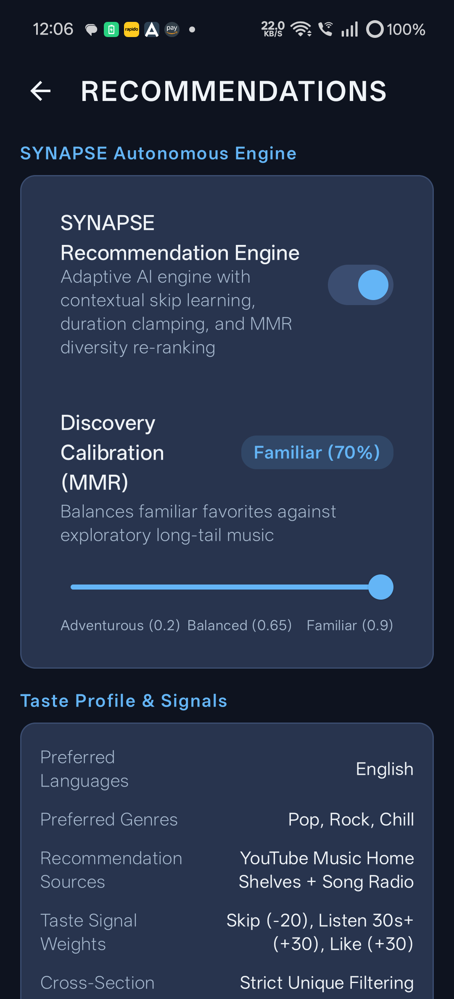

<p align="center">
  
</p>

<h1 align="center">STEREO</h1>

<p align="center">
  <strong>An independent, modern, open-source Android music player powered by Jetpack Compose and Material 3.</strong>
</p>

<p align="center">
  <a href="https://github.com/rishibandaru3109/STEREO/releases"></a>
  <a href="LICENSE"></a>
  <a href="https://developer.android.com/about/versions/oreo"></a>
  <a href="https://kotlinlang.org"></a>
  <a href="https://developer.android.com/jetpack/compose"></a>
  <a href="CONTRIBUTING.md"></a>
</p>

---

## 🌟 Overview

**STEREO** is a native Android music streaming and discovery application built from the ground up with Jetpack Compose, Kotlin Coroutines, and AndroidX Media3. STEREO combines high-fidelity audio playback with an advanced, personalized recommendation engine covering **40 mainstream languages** across the globe, automatic on-device audio caching for zero-data replays, and the autonomous **SYNAPSE** recommendation engine.

Everything is local-first: zero trackers, zero telemetry, zero mandatory user accounts, and zero cloud lock-in.

---

## 📸 Screenshots

<p align="center">
  
  &nbsp;
  
  &nbsp;
  
</p>

---

## ✨ Key Features

### ⚡ Automatic Audio Caching & Offline Replay
- **Seamless Streaming Replay:** Audio received during playback is automatically cached on-device in `no_backup/automatic_audio_v2` using Media3 `SimpleCache`.
- **Zero Redundant Data Transfers:** Replaying a cached song reuses local byte ranges immediately with zero network requests.
- **Offline Validated Playback:** Fully cached tracks can be played without an active internet connection.
- **Configurable Limits:** Select between 100 MB, 250 MB, 500 MB (default), 1 GB, or Unlimited directly from Settings. Least-recently-used eviction automatically reclaims space when limits are reached while strictly preserving currently playing audio.

### 🧠 SYNAPSE Autonomous Recommendation Engine
- **Personalized Behavioral Intelligence:** Learns dynamically from your real listening habits: tracks played to completion increase artist affinity, while accidental or mood-mismatch skips are confidence-weighted to prevent premature artist banishing.
- **Dual-Horizon Taste Modeling:** Separates short-term session vibes from long-term taste centroids so temporary workout sessions don't overwrite your favorite genres.
- **Dynamic Rails:** Quick Picks, Daily Mixes (4-quadrant covers), Weekly Discover, and "Because You Listened To [Artist]" rails powered by Maximal Marginal Relevance (MMR) diversity reranking.
- **Discovery Calibration (MMR):** Easily calibrate your discovery balance in Settings between Adventurous (0.2), Balanced (0.65), and Familiar (0.9).

### 🌍 40-Language Music Discovery
Discover music in the languages you actually love. STEREO features a searchable, multi-select language dialog organized across 5 regions with native typography and multi-script Unicode classification:
- **South Asia (11):** Hindi, Telugu, Tamil, Malayalam, Kannada, Bengali, Punjabi, Marathi, Gujarati, Urdu, Nepali.
- **Europe & Americas (11):** English, Spanish, Portuguese, French, German, Italian, Russian, Ukrainian, Polish, Dutch, Greek.
- **East & Southeast Asia (10):** Korean, Japanese, Mandarin Chinese, Cantonese, Indonesian, Malay, Thai, Vietnamese, Filipino, Burmese.
- **Middle East & Africa (6):** Arabic, Turkish, Persian, Hebrew, Swahili, Amharic.
- **Additional (2):** Romanian, Hungarian.

### 🎵 Premium Playback Experience
- **AndroidX Media3 / ExoPlayer:** Low-latency audio streaming with automated buffer management.
- **Background Playback & Lock-Screen:** Foreground service with rich media notification controls and gapless transitions.
- **Persistent Queues & Shuffle:** Save, inspect, reorder, and shuffle active listening queues.
- **Scroll-Aware Surprise Me FAB:** Auto-collapses to a compact 48.dp circular icon button during list scrolling and smoothly expands on idle.

### 🎨 Deep Theming & Visuals
- **7 Official Themes:** Classic Dark, True Black (AMOLED), Frosted Glass, Vintage Deck, Cyberpunk Neon, Pastel Breeze, and Deep Midnight.
- **2 Card Layout Modes:** Toggle between clean minimalist cards and detailed rich media cards.
- **Themed App Icon:** Full adaptive launcher icon suite and vector monochrome asset for Android 13+ Material You icon theming.

### 🔒 Privacy & Local Storage
- **100% On-Device Data:** Playlists, listening history, liked songs, and preferences are stored strictly in local SQLite via Room.
- **No Account Required:** No Google login, no subscription paywalls, no behavioral tracking, and no external telemetry SDKs.

---

## 📥 Download & Installation

### Requirements
- **Android Version:** Android 8.0 (Oreo, API 26) or higher.
- **Architecture:** `arm64-v8a`, `armeabi-v7a`, `x86_64`.
- **Permissions:** Internet and Foreground Service Audio.

### Get the Latest APK
1. Download `STEREO-v1.0.0-beta.1-release.apk` from the [Latest GitHub Release](https://github.com/rishibandaru3109/STEREO/releases).
2. Open the downloaded file on your Android device.
3. If prompted, allow installation from unknown sources for your browser or file manager.
4. Launch STEREO, select your favorite music languages, and enjoy!

---

## 🛠️ Technology Stack

| Layer | Framework / Library | Purpose |
| :--- | :--- | :--- |
| **Language** | Kotlin 2.0 | Modern concise Android development |
| **UI Toolkit** | Jetpack Compose (BOM 2024.06.00) | 100% declarative UI |
| **Design System** | Material 3 | Dynamic color tokens and adaptive theming |
| **Media Player** | AndroidX Media3 (1.3.1) / ExoPlayer | Streaming audio and system MediaSession |
| **Extraction** | InnerTubeX (v0.11.7) | YouTube Music catalog and stream resolution |
| **Database** | AndroidX Room (2.6.1) | Local persistence for history, likes, and playlists |
| **Preferences** | AndroidX DataStore (1.1.1) | Reactive preference storage for themes & languages |
| **DI** | Koin (3.5.6) | Lightweight dependency injection |
| **Image Loading** | Coil (2.6.0) | High-performance asynchronous image rendering |
| **Networking** | OkHttp (4.12.0) & Ktor (3.0.0) | Resilient HTTP streaming |

---

## 🔨 Building From Source

### Prerequisites
- [Android Studio Ladybug (2024.2.1)](https://developer.android.com/studio) or newer.
- JDK 17 or higher.
- Android SDK Platform 34 and Build-Tools 34.0.0.

### Steps
```bash
# Clone the repository
git clone https://github.com/rishibandaru3109/STEREO.git
cd STEREO

# Run unit tests (98 passing tests)
./gradlew testDebugUnitTest

# Build debug APK
./gradlew assembleDebug

# Build release APK
./gradlew assembleRelease
```
The compiled APK will be generated at `app/build/outputs/apk/`.

---

## ⚠️ Legal & Disclaimer

- **Unofficial API:** STEREO uses community-maintained extraction libraries (InnerTubeX) to interact with public YouTube Music endpoints.
- **Stream Availability:** Extracted audio stream URLs are temporary and generated on-the-fly by content servers; pausing playback for several hours may require refreshing the stream.
- **Trademark Notice:** YouTube and YouTube Music are registered trademarks of Google LLC. STEREO is an independent open-source project and is not affiliated with, authorized, maintained, sponsored, or endorsed by Google LLC or any of its affiliates.
- **Fair Use:** This application is provided for personal, non-commercial use only. Respect your local copyright laws.

---

## 🗺️ Roadmap

- [ ] Synced, interactive lyrics display.
- [ ] Offline audio caching and downloaded track playback.
- [ ] Android Auto playback support.
- [ ] Multi-select batch playlist management.
- [ ] Sleep timer with gradual volume fade-out.

---

## 🤝 Contributing

Contributions are welcomed! Please read our [Contributing Guide](CONTRIBUTING.md) and review our [Code of Conduct](CODE_OF_CONDUCT.md).

To report bugs or suggest enhancements, please use our [GitHub Issue Templates](https://github.com/rishibandaru3109/STEREO/issues/new/choose).

---

## 📄 License & Acknowledgments

This project is licensed under the **GNU General Public License v3.0 (GPL-3.0)** — see the [LICENSE](LICENSE) file for complete details.

Special thanks to the authors and maintainers of:
- [InnerTubeX](https://github.com/MetrolistGroup/innertubex) and [QuackJS](https://github.com/MetrolistGroup/quackjs)
- [AndroidX Media3](https://github.com/androidx/media)
- [Koin](https://github.com/InsertKoinIO/koin)
- [Coil](https://github.com/coil-kt/coil)
