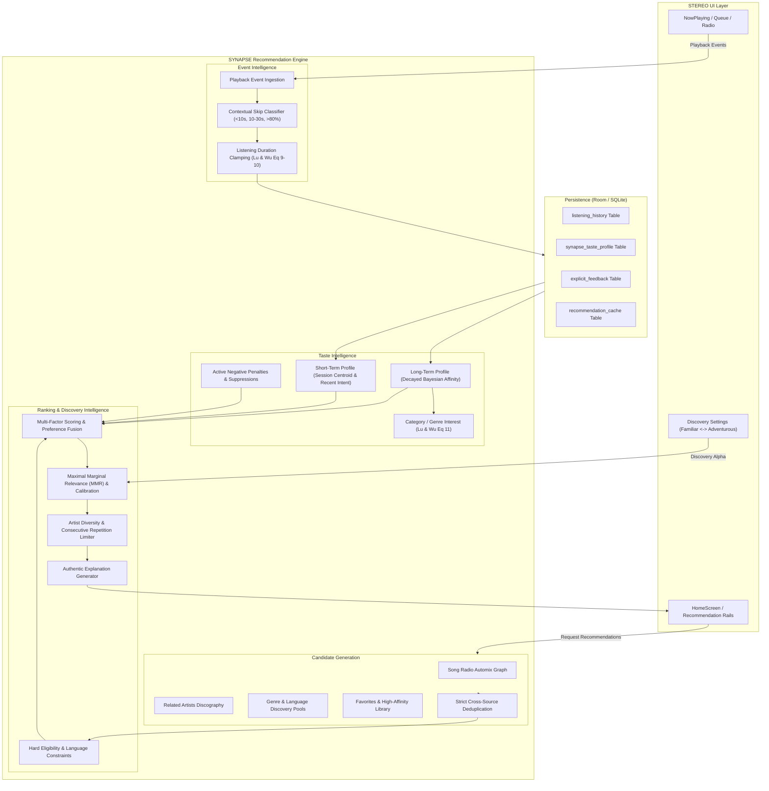
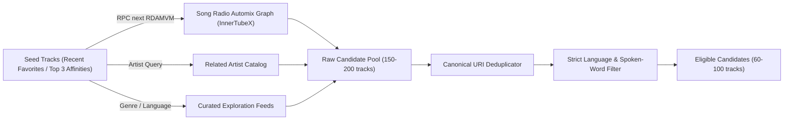

# SYNAPSE Architecture Specification

**Project:** SYNAPSE Recommendation Engine  
**Host Application:** STEREO (`com.nova.music`)  
**Document:** `docs/synapse/ARCHITECTURE.md`  
**Date:** November 2026  
**Status:** Approved Master Specification  

---

## 1. Architectural Philosophy & Design Principles

SYNAPSE is an original, modular, research-informed, local-first music intelligence and recommendation engine designed specifically for STEREO on Android. It adheres strictly to five foundational tenets:

1. **Strict Separation of Candidate Generation and Ranking:**
   - *Candidate Generation:* Answers *"Which songs across the catalog are potentially relevant to this listener?"* High recall, broad retrieval, coarse filtering ($K \approx 100\text{--}200$ tracks).
   - *Candidate Ranking:* Answers *"In what precise order should these candidates be presented to maximize satisfaction and discovery?"* High precision, fine-grained multi-factor scoring, diversity calibration ($K \approx 10\text{--}30$ tracks).
2. **Provider-Agnostic Core Domain:**
   - The core recommendation engine operates on canonical track identities, normalized metadata, and mathematical user profiles. It does not depend on expiring streaming URLs, player buffers, or provider network formats.
3. **Dual-Horizon Preference Modeling:**
   - Mathematical decoupling of persistent long-term taste (slow exponential decay, half-life $\approx 10$ days) from immediate short-term session intent (fast decay, half-life $\approx 1.5$ hours).
4. **Transparent Explainability:**
   - Every recommended item is tagged with a deterministic explanation derived from the dominant scoring component.
5. **Local-First Privacy & Zero Cloud Budget ($\mathbf{₹0}$):**
   - All profile computations, event logging, and ranking occur locally on the Android device in SQLite/Room and Kotlin coroutines.

---

## 2. Logical Subsystem Topology



---

## 3. Core Data Contracts & Domain Models

### 3.1 Domain Models Overview

```kotlin
package com.synapse.recommendation.model

/**
 * Stable, canonical identifier for tracks across providers and sessions.
 */
data class TrackIdentity(
    val uri: String,               // e.g. "yt:dQw4w9WgXcQ"
    val rawId: String,             // e.g. "dQw4w9WgXcQ"
    val namespace: String = "yt"   // "yt", "mbid", "local"
)

/**
 * Normalized track metadata used by SYNAPSE.
 */
data class SynapseTrack(
    val id: String,
    val title: String,
    val artist: String,
    val album: String? = null,
    val durationSeconds: Long = 0L,
    val thumbnailUrl: String = "",
    val language: String? = null,
    val genres: List<String> = emptyList(),
    val isSpokenWord: Boolean = false
)

/**
 * A candidate evaluated by the ranking pipeline.
 */
data class RecommendationCandidate(
    val track: SynapseTrack,
    val source: CandidateSource,
    val initialSeedId: String? = null,
    val initialScore: Double = 0.0
)

enum class CandidateSource {
    SONG_RADIO,
    ARTIST_RELATIONSHIP,
    FAVORITES_AFFINITY,
    DISCOVERY_SUPPLEMENT,
    RECENT_SESSION
}

/**
 * Contextual request parameter for generating recommendations.
 */
data class RecommendationContext(
    val currentTrackId: String? = null,
    val sessionHistory: List<SynapseTrack> = emptyList(),
    val excludedTrackIds: Set<String> = emptySet(),
    val targetSection: String = "HOME_FEED",
    val discoveryAlpha: Double = 0.65, // 0.0 = Most Familiar, 1.0 = Most Adventurous
    val preferredLanguages: Set<String> = emptySet(),
    val preferredGenres: Set<String> = emptySet(),
    val isPrivateListening: Boolean = false
)

/**
 * Final ranked recommendation with audit trail and explanation.
 */
data class RecommendationResult(
    val track: SynapseTrack,
    val rankScore: Double,
    val explanation: RecommendationExplanation,
    val components: Map<String, Double> = emptyMap()
)

data class RecommendationExplanation(
    val primaryReason: ExplanationType,
    val detailText: String
)

enum class ExplanationType {
    TOP_ARTIST_AFFINITY,
    SESSION_VIBE_MATCH,
    RADIO_GRAPH_RELATION,
    EXPLORE_GENRE,
    DISCOVER_NEW_ARTIST
}
```

---

## 4. Behavioral Intelligence & Event Accounting

### 4.1 Monotonic Playback Accounting & Clamping
Raw playback duration can easily distort recommendations:
- A user listening to a 10-minute classical piece should not be weighted 5x higher than a user listening to a complete 2-minute punk song.
- A user fast-forwarding or scrubbing should not be credited with multiple listens.
- A network buffer retry should not re-trigger a start event.

SYNAPSE applies Lu & Wu (2025) duration clamping with adaptive bounds:

$$\delta = \min(5000\text{ ms}, 0.10 \times \text{DurationMs})$$
$$\chi = \min(180000\text{ ms}, 0.85 \times \text{DurationMs})$$

$$t_{\text{effective}} = \text{clamp}(t_{\text{listened}}, \delta, \chi)$$
$$\kappa = \frac{t_{\text{effective}} - \delta}{\chi - \delta} \in [0.0, 1.0]$$

### 4.2 Event Weight Matrix
| Event Type | Condition | Long-Term Taste Delta | Session Intent Delta | Skip Penalty |
|---|---|---|---|---|
| **Full Completion** | $\text{ratio} \ge 0.80 \lor t_{\text{listened}} \ge 180\text{s}$ | $+30.0 \times \kappa$ | $+25.0$ | $0.0$ |
| **Partial Listen** | $0.30 \le \text{ratio} < 0.80$ | $+10.0 \times \kappa$ | $+10.0$ | $0.0$ |
| **Immediate Skip** | $t_{\text{listened}} < 10\text{s} \land \text{manual}$ | $-25.0$ | $-35.0$ | Full ($-40.0$) |
| **Mid-Song Skip** | $10\text{s} \le t_{\text{listened}} < 30\text{s}$ | $-10.0$ | $-15.0$ | Half ($-20.0$) |
| **Late Skip (Outro)** | $\text{ratio} \ge 0.80 \land \text{manual}$ | $+25.0$ | $+20.0$ | $0.0$ (Treated as Complete) |
| **Explicit Like** | User tapped Heart | $+50.0$ | $+40.0$ | $0.0$ |
| **Explicit Dislike** | User tapped Dislike | $-100.0$ (Blacklist) | $-100.0$ | Permanent Block |
| **Repeat Play** | Played twice within 1 hour | $+40.0$ | $+30.0$ | $0.0$ |

---

## 5. Candidate Generation Pipeline

Candidate generation combines multiple complementary retrieval paths to guarantee high recall:



---

## 6. Diversity & Maximal Marginal Relevance (MMR)

Given the scored candidate set $C$ and an already selected recommendation sequence $S$, the next track $c^*$ is selected by:

$$c^* = \arg\max_{c \in C \setminus S} \left[ \alpha \cdot \bar{S}(c) - (1 - \alpha) \cdot \max_{s \in S} \text{Sim}_{\text{content}}(c, s) \right]$$

Where:
- $\bar{S}(c)$ is the min-max normalized candidate relevance score.
- $\alpha \in [0.2, 0.9]$ is the user's discovery setting (**Familiar** = 0.85, **Balanced** = 0.65, **Adventurous** = 0.35).
- $\text{Sim}_{\text{content}}(c, s)$ measures artist identity, genre overlap, and token similarity.
- **Hard Artist Ceiling:** $\le 2$ consecutive tracks by the same artist; $\le 3$ tracks total per artist in a 15-track mix.

---

## 7. Persistence & Migration Architecture

SYNAPSE defines its Room entities with optimal SQLite B-Tree indices:
- `synapse_listening_events`: Indexed on `(trackId, timestamp)` and `(timestamp DESC)`.
- `synapse_artist_affinity`: Primary key `(artistNormalized)`, indexed on `(affinityScore DESC)`.
- `synapse_track_affinity`: Primary key `(trackId)`, indexed on `(affinityScore DESC)`.
- `synapse_explicit_feedback`: Primary key `(trackId)`.

Database version increments cleanly using non-destructive Room migrations with fallback preservation of existing STEREO tables.
