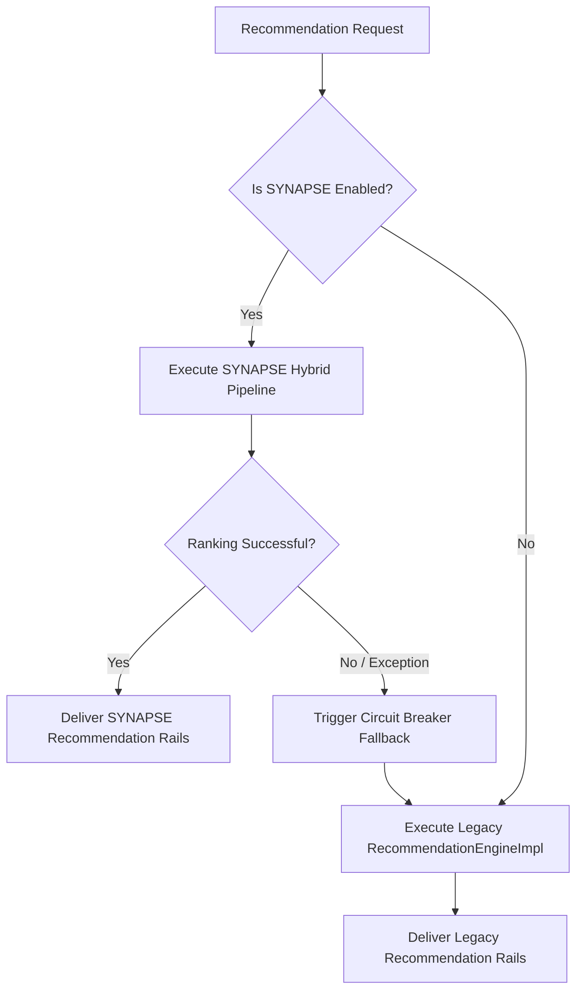

# SYNAPSE Feature Flagging, Safety & Rollback Specification

**Project:** SYNAPSE Recommendation Engine  
**Host Application:** STEREO (`com.nova.music`)  
**Document:** `docs/synapse/ROLLBACK.md`  
**Date:** November 2026  
**Status:** Approved Operational Protocol  

---

## 1. Feature Flag Architecture

SYNAPSE integration is gated behind an explicit runtime feature flag stored in Android DataStore preferences:

```kotlin
// DataStore Key in MusicPreferencesRepository
val KEY_SYNAPSE_RECOMMENDER_ENABLED = booleanPreferencesKey("synapse_recommender_enabled")
```

- **Default State:** Controlled rollout (`true` on internal personal builds, with instant toggle in Settings $\to$ Playback & Recommendations $\to$ "SYNAPSE Recommendation Engine").
- **Zero-Crash Fail-Safe (Circuit Breaker):** If SYNAPSE throws any unhandled runtime exception during candidate ranking, the recommendation coordinator automatically catches the error, logs diagnostics via `Log.e("SYNAPSE_CIRCUIT_BREAKER", ...)`, and silently delegates recommendation generation to STEREO's legacy `RecommendationEngineImpl`.

---

## 2. Fallback Pipeline Hierarchy



---

## 3. Database Isolation & Non-Destructive Storage

1. **Table Namespacing:**
   - All SYNAPSE-specific tables use the `synapse_` prefix (e.g. `synapse_listening_events`, `synapse_taste_profile`, `synapse_active_penalties`).
   - Legacy STEREO tables (`listening_history`, `liked_songs`, `tracks`, `recommendation_cache`, `explicit_feedback`) remain untouched.
2. **Zero-Data-Loss Rollback:**
   - Disabling SYNAPSE via settings or git rollback does NOT require uninstalling the application or wiping app data.
   - User playlists, liked songs, playback history, and audio cache remain 100% intact.

---

## 4. Rollback Execution Commands

In the event that an emergency rollback is required:

### Option A: Runtime Toggle (No Code Deployment)
1. Open STEREO $\to$ **Settings** $\to$ **Playback & Recommendations**.
2. Toggle **SYNAPSE Recommendation Engine** to **OFF**.
3. STEREO immediately returns to the original recommendation algorithm.

### Option B: Build-Time / Git Branch Rollback
Because SYNAPSE is engineered as an independent module/package and tested in an isolated branch:
```bash
# In C:\Users\B.Rishi\Downloads\music player
git checkout master
./gradlew testDebugUnitTest
```
The master branch remains untouched and functional at all times.
